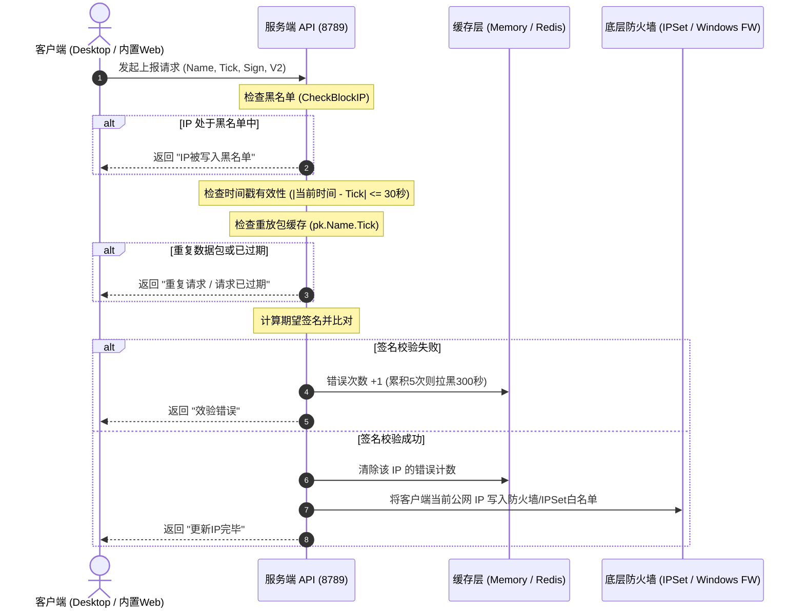

# FirewallSetting - Windows/Linux 动态服务器防火墙白名单管理系统

[](https://github.com/)
[](https://dotnet.microsoft.com/)
[](https://github.com/)
[](docs/)

> **让服务器的敏感端口对外隐形，只允许可信设备动态接入！**
> 本项目通过强安全签名机制，实现客户端自动、静默地将本地动态公网 IP 同步至云端服务器防火墙白名单，杜绝暴力破解与未授权端口扫描。

---

## 快速导航 / Documentation

| 文档模块 | 内容简要 | 快捷链接 |
| :--- | :--- | :--- |
| 🐧 **Linux 部署与配置** | Systemd 原生服务安装 / Supervisord 部署 / 内置 Web 端 / `App.config` 与规则配置 | [👉 查看 Linux 部署指南](docs/deploy-linux.md) |
| 🪟 **Windows 部署与配置** | Windows 服务端部署 / Windows 高级防火墙联动 / 计划任务自启 / 配置参数全解析 | [👉 查看 Windows 部署指南](docs/deploy-windows.md) |
| 💻 **使用指南 (双端协同)** | Linux CLI 管理命令 / Windows GUI 操作 / Windows 桌面托盘端 / 内置 Web 客户端操作 | [👉 查看完整使用指南](docs/usage.md) |

---

## 场景分析与痛点解决

当我们在公网购买了云服务器/VPS并开启远程连接（如 Windows 远程桌面 3389、Linux SSH 22、MySQL 3306、Redis 6379、SVN 等）后，哪怕修改了默认端口，每天仍会遭受成千上万次来自全网恶意扫描脚本的暴力猜测与漏洞利用。

- **传统固定白名单**：家庭或办公网络宽带普遍使用动态公网 IP（PPPoE 拔号或 DHCP 分配），每次重拨或租约到期后 IP 就会改变，导致固定白名单频繁失效或配置维护成本极高；
- **自建 VPN / 专线**：成本高昂、架构复杂，且客户端常遇到连线中断、网络延迟高与穿透失败等问题；
- **本项目解决方案**：
  服务端开启轻量级安全校验 API，授权客户端机器在后台每 **5 分钟** 自动上报一次本机的最新公网 IP。服务端通过防重放、签名防伪造与防爆破黑名单多重校验后，将合法 IP **毫秒级写入底层防火墙白名单（基于 IPSet 或 Windows 原生高级防火墙）**，未被授权的外部 IP 完全无法连接受保护端口。

---

## 核心特性

- 🛡️ **双平台原生支持**：
  - **Linux 端**：基于 .NET 8.0 构建，支持 CentOS、Ubuntu、Debian 等主流发行版，无缝适配 `ipset`、`iptables`、`firewalld`、`ufw` 与 `nftables`；
  - **Windows 端**：基于 .NET Framework 4.8 构建，直接调用 Windows 高级安全防火墙原生 COM 接口（`HNetCfg.FwPolicy2`），精准调整规则作用域。
- ⚡ **多种部署方案**：
  - **Linux 服务化**：支持 **Systemd 系统原生服务**（一键开机自启与守护）及 **Supervisord 守护进程**（附带 Web 管理控制台与交互终端）；
  - **Windows 服务化**：支持界面一键设置开机自启、Windows 计划任务最高特权运行以及 NSSM 系统服务。
- 📱 **多端客户端适配**：
  - **Windows 桌面客户端 (`FWSettingClient`)**：轻量系统托盘运行、无感知静默同步、多服务器同时维护、开机自启；
  - **服务端内置 Web 客户端（开箱即用）**：**无需额外单独部署 Web 服务**，服务端已原生集成 Web 端。任何平台用户只需访问 `http://<服务器IP>:<监听端口>/web/index.html` 即可使用浏览器完成白名单维护与自动同步。*(注：早期的独立工程 FWSettingWebClient 已废弃并集成到服务端)*。
- 🔐 **严苛的企业级安全机制**：
  - **V1 / V2 双签名算法**：采用多段独立 GUID 密钥（默认 3 段）与时间戳进行 SHA-1 哈希签名，数据包内容与 IP 强绑定；
  - **防重放攻击 (Anti-Replay)**：时间戳差值必须在 30 秒以内，30 秒内重复数据包由缓存层拦截丢弃；
  - **防暴力破解黑名单 (Brute-Force Defense)**：5 分钟内连续 5 次校验失败的 IP 会被自动写入黑名单封禁 5 分钟；
  - **灵活缓存支持**：内置单机高性能内存缓存（`web`），同时支持生产环境分布式 `redis` 缓存驱动。

---

## 项目组件结构

```text
FirewallSetting/
├── SourceCode/
│   ├── FirewallSetting/            # Windows 服务端主程序（WinForms 桌面GUI，内置 Web 客户端）
│   ├── FirewallSettingServerCore/  # Linux 服务端核心守护程序（.NET 8.0 控制台 / 服务，内置 Web 客户端）
│   ├── FWSettingClient/            # Windows 客户端桌面程序（WinForms 系统托盘）
│   ├── FirewallSettingSSHLib/      # Linux 防火墙适配层（ipset、iptables、ufw、nftables）
│   ├── SettingLib/                 # 核心协议类库、缓存层与 Win32 防火墙接口、内置 Web 处理器
│   └── FWSettingWebClient/         # [已废弃] 早期独立 Web 客户端（功能已直接内置进服务端 App_Data/web）
└── docs/
    ├── deploy-linux.md             # Linux 详细部署与配置指南（含 Systemd / Supervisord）
    ├── deploy-windows.md           # Windows 详细部署与配置指南（含 Windows 防火墙联动）
    └── usage.md                    # 客户端与服务端完整使用指南（操作对比）
```

---

## 技术实现与安全协议

### 1. 签名校验原理

服务端管理员创建用户后，会生成专属的安全凭据 `Secret`（由若干段独立 GUID 拼接而成，如 `GUID1|GUID2|GUID3`）并导出配置 JSON。

#### V1 签名算法：
$$\text{Sign} = \text{SHA1}(\text{"name="} + \text{UrlEncode}(UserName) + \text{"\&secret="} + \text{UrlEncode}(Secret) + \text{"\&tick="} + Tick)$$

#### V2 签名算法（推荐与默认开启）：
V2 模式将请求的来源 IP、各段 Secret 与时间戳深度哈希，各段哈希以 `|` 拼接：
$$\text{Hash}_i = \text{SHA1}(\text{"name="} + \text{UrlEncode}(UserName) + \text{"\&secret="} + Secret_i + \text{"\&tick="} + Tick + \text{"\&ip="} + ClientIP)$$
$$\text{SignV2} = \text{Hash}_1 + \text{"|"} + \text{Hash}_2 + \text{"|"} + \text{Hash}_3$$

### 2. 校验流程示意


---

## 部署与配置快速指引

根据您的服务器操作系统，请直接前往对应子文档查看完整的实战部署教程：

### 🐧 [前往 Linux 部署与配置指南](docs/deploy-linux.md)
- **部署方式**：
  - **Systemd 原生系统服务（全新支持）**：通过 `/etc/systemd/system/firewallsetting.service` 进行标准 Linux 服务化托管与自启；
  - **Supervisord 守护方式**：通过 `/etc/supervisord.d/firewallsetting.ini` 运行并开启 Web 仪表盘监控。
- **配置与规则**：
  - `App.config`：监听地址、固定放行白名单网段、防火墙强制类型选择、本地/SSH执行模式；
  - `App_Data/firewallRule.xml`：需要受白名单保护的端口列表（SSH 22、MySQL 3306 等）。
- **内置 Web 客户端**：服务端启动后自动开放 `http://<服务器IP>:<监听端口>/web/index.html`，无需安装额外 Web 依赖。

### 🪟 [前往 Windows 部署与配置指南](docs/deploy-windows.md)
- **部署方式**：
  - 目录解压与管理员权限启动；
  - Windows 高级安全防火墙规则前置联动（在系统高级防火墙中预先创建入站规则）；
  - 开机自动运行与 Windows 任务计划程序高特权守护。
- **配置与规则**：
  - `FirewallSetting.exe.config`：监听设置与固定放行网段；
  - `App_Data/firewallRule.xml`：通过 `ruleName` 精准匹配已有的 Windows 入站规则并动态覆写远程 IP 地址范围。
- **内置 Web 客户端**：同 Linux 服务端一致，直接访问 `http://<服务器IP>:<监听端口>/web/index.html`。

---

## 客户端使用快速指引

详细图文操作请参阅：👉 [客户端与服务端使用指南](docs/usage.md)

1. **服务端生成配置**：
   - **Linux**：在终端控制台执行 `user add 用户名 1`，复制打印出的 JSON 配置码；
   - **Windows**：在图形界面用户列表空白处右键选择“新增用户”，随后右键点击“复制此用户配置”。
2. **客户端导入使用**：
   - **Windows 桌面端 (`FWSettingClient`)**：右下角托盘双击打开主窗口 -> 右键已加载服务选择“添加” -> 粘贴配置码 -> 自动开始每 5 分钟静默同步；
   - **内置 Web 网页端 (`/web/index.html`)**：在浏览器打开 `http://<服务器IP>:<监听端口>/web/index.html` -> 在“操作配置”框中粘贴配置码并点击“添加服务” -> 页面保持开启时每 60 秒自动同步。

---

## 平台与功能对比表

| 对比维度 | Linux 服务端 (ServerCore) | Windows 服务端 (WinForms) | Windows 桌面客户端 | 服务端内置 Web 客户端 |
| :--- | :--- | :--- | :--- | :--- |
| **运行平台** | Linux (CentOS/Ubuntu/Debian) | Windows Server 2012+ / 10 / 11 | Windows 7 / 10 / 11 | 任何支持现代浏览器的设备 |
| **运行时依赖** | .NET 8.0 Runtime | .NET Framework 4.8 | .NET Framework 4.8 | 无需安装，浏览器直接访问 |
| **部署方式** | Systemd 服务 / Supervisord | 应用程序管理员运行 / 计划任务 | 解压即用，支持开机托盘自启 | **直接内置在服务端中，免额外部署** |
| **底层实现** | IPSet / iptables / ufw / nft | Windows Defender Firewall (COM) | WinForms 后台多线程 | HTML5 / JQuery / 本地 LocalStorage |
| **访问/服务端口** | 默认 `8789` | 默认 `8789` | 本地后台进程 | 与服务端同端口（`/web/index.html`） |
| **自动同步周期** | 服务端每 5 分钟定时自刷新 | 服务端每 5 分钟定时自刷新 | 客户端每 5 分钟自动上报 | 网页端每 60 秒自动上报 |
| **数据存储介质** | `userInfo.xml` / `firewallRule.xml` | `userInfo.xml` / `firewallRule.xml` | `accont.xml` / 注册表 | 浏览器 `localStorage` (`fwservers`) |

---

## 常见排错速查 (FAQ)

- **Q: 客户端提示“请求已过期”？**  
  A: 本系统为防御网络重放攻击，强制要求客户端与服务端时间误差在 30 秒以内。请检查服务器与客户端的时钟，并在服务器上配置 NTP 时间校准（如 `chronyc makestep` 或 Windows 自动对时）。
- **Q: 客户端提示“效验错误，IP被屏蔽”？**  
  A: 连续输入错误密钥超过 5 次会触发 5 分钟防爆破封禁。请确认配置码是否粘贴完整无误，等待 5 分钟解除封禁后再试。
- **Q: Windows 服务端无法更新防火墙规则？**  
  A: `FirewallSetting.exe` 必须**以管理员身份运行**；同时确认 `firewallRule.xml` 中的 `ruleName` 与 Windows 高级防火墙中已有规则的名称完全一致。
- **Q: Web 客户端需要单独安装环境或者开独立端口吗？**  
  A: 不需要！原有的 `FWSettingWebClient` 已经废弃并原生集成到了服务端中。只要服务端启动（监听如 8789 端口），通过浏览器访问 `http://<服务器IP>:8789/web/index.html` 即可直接使用 Web 版客户端。
- **Q: 宽带重新拔号换了新 IP，多久能够恢复访问？**  
  A: 客户端会在下一次 5 分钟周期到达时自动同步。若需立即连接，只需在客户端主界面点击“同步IP到服务器”或 Web 版点击“手动同步”，数秒内即可恢复通行。
